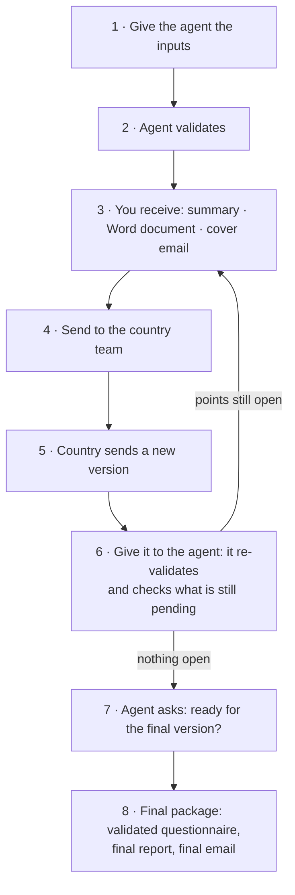

# Standard validation procedure (operators)

This page is for anyone who validates a country questionnaire with the
Claude agent in this repository. The agent follows the same steps every
time, so the result does not depend on who runs it. Developers: the agent's
side of this procedure is in `.claude/skills/diem-validate/SKILL.md`.

## The loop at a glance

## 0. The agent explains the steps first

When you start a new validation, the agent first tells you in a few lines
what will happen: the inputs it needs, the validation, the points to fix or
to confirm, the loop with the country's new versions, and the final
validated version once nothing is pending. Then it asks for whatever input
is missing. For a new version of an ongoing case it only reminds you where
you are ("round 2 — checking the new version against 3 open points").

It also looks at the **history of the country**: the earlier rounds, the
problems found then and how they were solved. If an issue comes back, it
tells you in one line what worked last time.

## 1. What to give the agent

The agent needs these before it runs. If something is missing it asks; it
does not guess.

| Input | Example | Notes |
|---|---|---|
| **Where the file is** | `C:\Users\…\Downloads\diem_household_questionnaire_geopoll_yemen_20261022.xlsx` | Any local or OneDrive path. The agent works on a copy and never changes the original. |
| **KoBo or GeoPoll** | GeoPoll | |
| **Reference** | latest template | Or *previous round*: then also give the previous-round file. |
| **Languages to check** | Arabic | English is always checked. Add every language used in the interview. |
| Country and round | Yemen, R1 | The agent proposes them from the file name; confirm or correct. |

A first message can be as short as:

> Validate `C:\…\diem_household_questionnaire_geopoll_yemen_20261022.xlsx`, GeoPoll, latest template, Arabic. Yemen R1.

The latest templates are taken automatically from the DIEM Toolbox
(`03. Toolbox/02. Questionnaires`) before each run.

## 2. What you get after each validation

1. **Summary message** (in the chat): ready / not ready, the reference used,
   the languages checked, the number of issues, and the points to solve,
   grouped by part of the questionnaire and marked **to fix** or **to
   confirm**. From the second round on, it also says what was fixed and what
   is still pending from before.
2. **Word document for the country team**: one section per part of the
   questionnaire, each point with sheet, row, variable and column name, and
   what to copy from the template. Problems found in the template itself are
   listed apart (for SMAR); the country has nothing to do on those.
3. **Short cover email** to send with the document.

All results go in the DIEM questionnaire validation folder in Temp, split by
tool, with one folder per country and round:
`C:\Temp\DIEM_questionnaire_validation\<geopoll|kobo>_output\validation_cases\<ISO3>_<round>\`.
Older reports are archived automatically; case folders are never deleted
(see [Case folder and outputs](case-folder.md)).
The agent also keeps there the list of points and their status, so it
remembers the case in later sessions.

## 3. Sending a new version

When the country sends a revised file, give it to the agent:

> New version of Yemen R1: `C:\…\diem_household_questionnaire_geopoll_yemen_20261023.xlsx`

You do not need to repeat the tool, reference or languages: the agent reads
them from the case. It validates again, compares with the open points, and
tells you which are fixed, which are still open, and anything new.

## 4. Closing a point yourself

Some points are solved outside the file: SMAR accepts an exception, the
country confirms a choice. Tell the agent, with who decided:

> Point P04 is accepted: SMAR said 3 agriculture coping strategies are fine for Yemen.

> The airtime sentence was removed on purpose, the country confirmed there is no incentive.

The point is then closed as **accepted** and appears in the final report as
an agreed exception, with who agreed it. A point can also be **dropped** if
it turns out not to be a problem.

## 5. Final version

When no point is open, the agent asks whether to produce the final package.
On your yes it creates, in the case folder:

- **`<ISO3>_<round>_<tool>_validated_questionnaire_FINAL.xlsx`**: the validated
  questionnaire (placeholders replaced, crop list sorted, admin lists from
  AGOL) to send to GeoPoll / deploy in KoBo;
- **`<ISO3>_<round>_<tool>_final_validation_report.docx`**: questions by type
  (mandatory, recommended, low priority, customized), questions added and
  removed by type, admin levels and number of units, selected crops,
  interview length, the fixes made in each round, the accepted exceptions
  with who agreed them, and the template issues reported to SMAR;
- a **final email** text.

## Status words

| Status | Meaning |
|---|---|
| open | still to be solved |
| fixed | gone in a later version (the agent checks it) |
| accepted | kept on purpose, agreed by someone you named |
| dropped | not a real problem, withdrawn |

| Point type | Who acts |
|---|---|
| To fix | country: change the file |
| To confirm | country: confirm the difference is intended, or copy the template |
| Placeholder | country: type the value in Additional information |
| Optional | country, if they want: cleanup with no effect on the data |
| Template side | SMAR: the template itself needs correcting |
